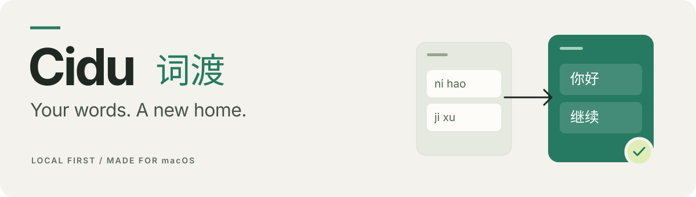
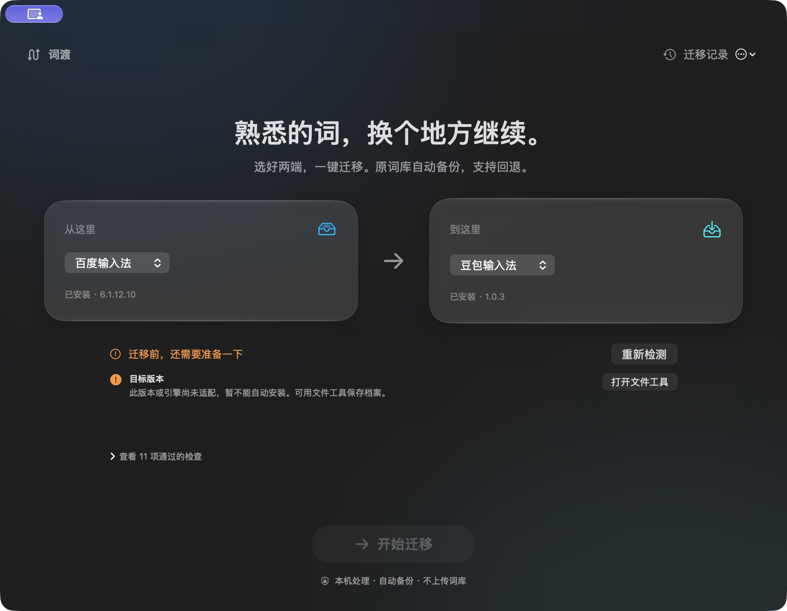

<p align="center">
  
</p>

<p align="center">
  <strong>Bring your personal dictionary to your next input method.</strong><br>
  Native macOS app · Local processing · Automatic backups · Agent-ready CLI
</p>

<p align="center">
  <a href="https://github.com/shenyangs/cidu/releases/tag/v0.8.0"></a>
  
  <a href="LICENSE"></a>
  <a href="https://github.com/shenyangs/cidu/actions/workflows/ci.yml"></a>
</p>

<p align="center">
  <a href="README.md">简体中文</a> · <strong>English</strong><br>
  <a href="https://github.com/shenyangs/cidu/releases/download/v0.8.0/Cidu-0.8.0-macOS-arm64.dmg">Download for macOS</a> ·
  <a href="https://github.com/shenyangs/cidu/releases/tag/v0.8.0">All release files</a> ·
  <a href="CONTRIBUTING.md">Contribute</a>
</p>

---

Your dictionary holds names, everyday expressions, and years of typing habits. Switching input methods should give those words a way to come along.

Cidu brings reading, compatibility checks, conversion, backups, and migration into one native window. Use a supported official export flow, or save your dictionary as an archive you can reopen later. When an encoding cannot be verified, Cidu keeps the original data and explains what needs attention.

| Native experience | Preserve the source | Stay in control |
| :--- | :--- | :--- |
| SwiftUI with guided permissions; Liquid Glass on macOS 26+ | Keep the original file, full archive, unmigrated entries, and reasons | No account or telemetry; the GUI and CLI share the same migration logic |

> **0.8.0 is a public preview.** Automatic migration supports the official export from **Baidu Mac 6.1.12.10 → a specific Doubao Mac 1.0.2 engine**. Local versions, engine fingerprint, and account are checked before installation. **Doubao 1.0.3 and unknown engines are blocked**; file tools remain available for archiving. See the table below and the [validation log](docs/VALIDATION.md) for the distinction between format support and tested installation.

## Get started

1. Download the [DMG](https://github.com/shenyangs/cidu/releases/download/v0.8.0/Cidu-0.8.0-macOS-arm64.dmg), drag **词渡** into Applications, and open it. Release binaries are Developer ID signed and Apple notarized.
2. Choose the source and destination, then resolve any pending checks. Automatic Baidu export requires you to grant Accessibility permission in System Settings. An existing export file can be used instead.
3. Review the plan. When some entries need adaptation, Cidu shows separate counts for new, existing, and unmigrated entries. Partial installation requires an explicit choice to migrate only verified entries.
4. Check sample words in the destination input method, then restart it and check again. Migration history can restore the previous backup; restoration refuses to overwrite a dictionary that has learned new content since migration.

Release binaries target **Apple Silicon** with a **macOS 13** deployment minimum. Hands-on testing used macOS 27.0.1; other OS versions, Intel, and a second device have not been tested. The app UI is currently in Chinese.

<details>
<summary><strong>See the app</strong></summary>

<p align="center"></p>

This read-only preflight screenshot shows the current machine after Doubao updated to 1.0.3. The version gate correctly blocks automatic installation. No personal dictionary entries are shown.

</details>

## How migration works

```text
Read source → Check compatibility → Plan → Validate a copy → Back up → Install & read back
                                    ↓
                       Keep full source and unmigrated entries
```

Before installation, Cidu quits the destination input method, rechecks the account, file, and hashes, then commits an atomic replacement. Both installation and restoration persist their intent first. After an interruption, history reconciles the current file against the before/after snapshots. External changes stop further writes.

Backups live in `~/Library/Application Support/Cidu/Transactions`, with `0700` directory and `0600` file permissions. New 0.8 plans retain `source.original`, the full `source.json`, a reopenable `unmigrated.json`, and `unmigrated-reasons.json`. File-conversion bundles and automatic-installation backups are separate artifacts; creating an export does not install it.

## Formats & compatibility

| Source / format | Read | Export | Current scope |
| :--- | :---: | :---: | :--- |
| Baidu Mac official TXT export | ✓ | ✓ | Real exports and round trips tested; importing into Baidu is unverified |
| Sogou Pinyin TXT | ✓ | ✓ | GBK; no SCEL / BIN; weights are not retained |
| Rime / Squirrel `.dict.yaml` | ✓ | ✓ | Explicit full-pinyin text / code / weight columns; no import_tables expansion or userdb |
| Doubao Mac `usr.dat` | ✓ | Archive | Preserve syllable IDs and raw attributes; automatic installation only for the adapted 1.0.2 engine |
| QQ Pinyin TXT | ✓ | ✓ | Three pinyin / text / frequency columns; UTF-16 LE output; no comma extensions, QPyd / Qcel |
| Google Pinyin text | ✓ | ✓ | GBK text / frequency / pinyin columns for legacy dictionaries |
| macOS Text Replacements PLIST | ✓ | ✓ | XML / binary input, XML output; use the official system drag-in / drag-out flow |
| Microsoft `mschxudp` custom phrases | ✓ | Archive / Mac | Preserve shortcuts and candidate positions; no DCTX or Windows installer |
| Complete WeType Mac LevelDB copy | Experimental | Recognized entries | Known keys only, full snapshot retained; no write-back or real-version validation |
| Cidu JSON / TSV | ✓ | ✓ | Retain duplicates, alternate readings, raw fields, and internal codes; reopenable |

Apart from the Baidu / Doubao testing noted above, real imports or deployment into the other input methods remain unverified. Not every format pair can be converted without loss:

- **Encoding and frequency:** unsupported characters, ambiguous syllable boundaries, and unknown codes are never silently discarded. Rime exports use weight 1. Baidu values are retained for Baidu sources; other sources use placeholder 1. QQ / Google frequencies survive same-format exports only. Original values stay in JSON / TSV; candidate order, predictions, and learning history are not guaranteed to transfer.
- **Pinyin and shortcuts:** users must confirm a Rime dictionary uses full pinyin. Shape codes and double pinyin cannot be identified reliably from structure alone. Shortcuts are modeled separately; learned dictionaries do not automatically become Text Replacements. System phrases support single-line values and known fields only.
- **WeType experiment:** quit the input method and copy the complete database folder before selecting that copy. CURRENT, its referenced MANIFEST, and every data / log file are required; the limit is 40 MB. Only `!u_d_v_p!` keys are recognized, so the recognized count is not a complete learned-dictionary count. The macOS learned dictionary is not supported.

See the [compatibility protocol](docs/COMPATIBILITY.md) and [third-party notes](THIRD_PARTY.md) for details. Technical logs are currently in Chinese.

## Use with an AI agent

Copy the instructions from **更多工具 → 交给我的 AI 助手** (“More Tools → Give to my AI assistant”), or install the release's [Agent Skill](https://github.com/shenyangs/cidu/releases/download/v0.8.0/Cidu-0.8.0-agent-skill.zip). This requires an agent that can access local files and run commands. Cidu currently provides a **CLI + Skill**, without an MCP server.

The CLI ships inside the complete app. Adjust the path to your installation and keep it beside `EngineProbe`:

```sh
"/Applications/词渡.app/Contents/MacOS/cidu-cli" help
"/Applications/词渡.app/Contents/MacOS/cidu-cli" status --file "/path/to/export.txt"
"/Applications/词渡.app/Contents/MacOS/cidu-cli" plan --file "/path/to/export.txt"
"/Applications/词渡.app/Contents/MacOS/cidu-cli" history
```

`status` only checks the environment. `plan` prepares private candidates and backups and validates an isolated copy; it does not install the dictionary. Omitting `--file` operates Baidu's official export window and requires the relevant permissions. Plans expire after 24 hours.

After the user has authorized installation or restoration, use the following commands. A partial migration also requires explicit acceptance before adding `--allow-partial`:

```sh
"/Applications/词渡.app/Contents/MacOS/cidu-cli" apply PLAN_ID --confirm
"/Applications/词渡.app/Contents/MacOS/cidu-cli" restore RECEIPT_ID --confirm
```

Each command emits one JSON object. Exit codes are `0` for success, `2` for an unready environment, and `1` for argument or operation errors. `status.ok` means inspection completed; `ready` means basic requirements passed. Only `installed` means installation occurred. `--confirm` expresses write intent; it does not grant system permissions or establish user authorization. The full behavior contract is in [SKILL.md](skills/cidu-migrate/SKILL.md).

## Privacy & retention

Cidu contains no network-request, account, or telemetry code. Parsing, conversion, and backups run locally. Files saved to a cloud-synced folder may be uploaded by macOS or the sync client. Agents should discuss counts and checks, without sending complete dictionaries, backups, or raw logs to remote models.

Bundle hashes detect corruption and changes; they do not authenticate the author. Cidu does not enable system permissions, modify the TCC database, or choose between multiple destination accounts. Keep personal dictionaries outside the repository.

## Build from source

You need an Apple Silicon Mac, **Xcode 26+ or Command Line Tools with a macOS 26+ SDK**, CMake 3.16+, and Python 3. If CMake is missing, the scripts can use `uvx` to download a pinned CMake version on first use. LevelDB 1.23 and Snappy 1.2.1 sources are included; the built app does not require Homebrew.

```sh
git clone https://github.com/shenyangs/cidu.git
cd cidu
bash scripts/test.sh
bash scripts/test-preflight.sh
bash scripts/build.sh
open "build/词渡.app"
```

If the Apple toolchain is missing, run `xcode-select --install` first. Confirm that `xcrun --sdk macosx --show-sdk-version` is at least 26. Install CMake from its [official downloads](https://cmake.org/download/), or, with uv available, check the fallback using `uvx --from cmake==3.31.6 cmake --version`.

Development builds use ad-hoc signing, unlike notarized releases. `VERSION` / `BUILD_NUMBER` are the single version source. `python3 scripts/package-public.py` creates the source ZIP, Skill ZIP, and release checksums from an [explicit file manifest](scripts/public-files.txt). See [CONTRIBUTING.md](CONTRIBUTING.md) for signing, notarization, architecture, and test boundaries.

## What's new in 0.8.0

- Reconcile interrupted installation and restoration against snapshots before further writes.
- Keep the complete source and unmigrated archive; require an explicit partial-migration choice.
- Bound file reads and reject special files, unsafe permissions, and more malformed inputs.
- Distinguish prepared, partial, unchanged, and restored results; preserve unknown legacy counts.
- Unify versioning and public packaging; **161 core checks + 17 preflight checks** pass.

Next priorities are validation on more devices and OS versions, adapting to input-method upgrades, and adding official import flows for more destinations. Progress and limitations are recorded in the [remediation log](docs/REMEDIATION-0.8.md), [validation log](docs/VALIDATION.md), and [product roadmap](docs/PRODUCT.md).

## Contributing & license

Compatibility reports, synthetic fixtures, format adapters, and English UX improvements are welcome. Include versions, reproduction steps, and redacted errors in issues; avoid uploading personal dictionaries. Start with [CONTRIBUTING.md](CONTRIBUTING.md).

Cidu source is licensed under the [MIT License](LICENSE). Licenses and provenance for LevelDB, Snappy, and format references are documented in [THIRD_PARTY.md](THIRD_PARTY.md). Cidu is an independent project, unaffiliated with the input-method vendors mentioned here. Their frameworks, installers, and personal dictionaries are not distributed.
